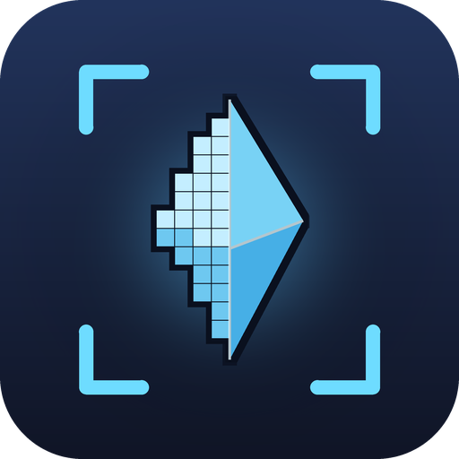

# UpscaleBuddy

A Dalamud plugin for Final Fantasy XIV. It replaces the upscaler on the game's DLSS path with other temporal upscalers.

## Features

- **FSR 3.1**, built into the plugin. It works on all GPUs.
- **FSR 4**, through AMD's FSR DLL on D3D12. It needs a GPU and driver that support it.
- **XeSS**, through Intel's XeSS DLL on D3D12.
- Quality presets and Native AA.
- **Frame generation** with AMD FSR frame generation. The game UI and nameplates do not go into the generated frames.
- A low-latency frame limiter. It replaces the game's 60/30 fps limit.

## Usage

Type `/upscalebuddy` in game to open the settings.

## License

MIT. See [LICENSE](LICENSE). FidelityFX and XeSS have their own licenses in `Shaders/`.
